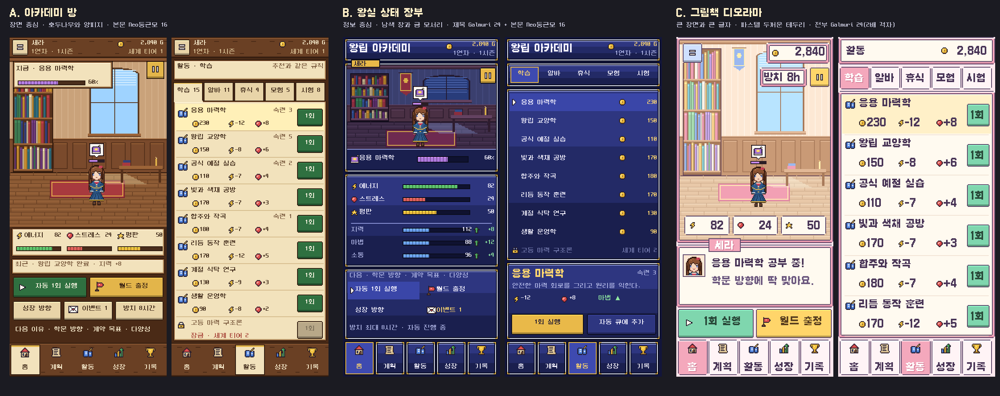
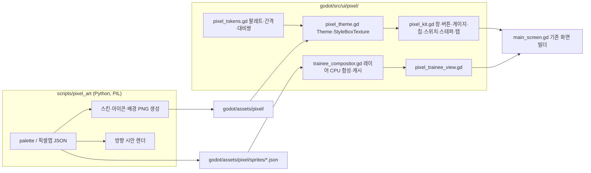

# 설계: 픽셀 육성 시뮬레이션 UI/UX 개편

- 설계 ID·버전: `2026-11-pixel-raising-ui` v1, 기준 커밋 `d6a9926`(E2E 여정 병합 직후 main)
- 상태: 승인(2026-11-04). 방향 A. 아카데미 방.
- 관련: PR #1(E2E 여정), [방향 시안](../../game-design/ui/directions-v1.png), [레퍼런스 조사](../../game-design/ui/research.md), [테스트 계획](test-plan.json)

## 목적·범위·근거

지금 화면은 Noto Sans 고딕과 평면 카드로 된 "현대 모바일 카드 UI"다(GDD §11). 사용자는 이를 저해상도 도트의 픽셀 육성 시뮬레이션 화면으로 바꾸기를 원한다. 2026-11-04 사용자 결정은 다음과 같다.

| 결정 | 내용 |
|---|---|
| 표현 | 캐릭터, 배경, 창, 아이콘을 모두 저해상도 도트로 그리고 정수 배율(아트 1px = 논리 2px)로 키운다. 글자는 한글 픽셀 폰트(OFL)다 |
| 제작 | 모든 도트를 코드와 픽셀맵으로 만든다. 이미지 생성 API는 쓰지 않는다. 캐릭터는 성장과 장비가 보이는 페이퍼돌 레이어를 유지한다 |
| 범위 | GDD 10.1의 12개 화면 전체와 결과 연출 |

현재 화면의 문제는 개편 전 기준선 캡처(E2E 렌더링 모드 20장)에서 확인했다. 결과 카드와 토스트가 버튼과 목록을 가리고, 정보 카드가 모두 같은 무게로 쌓여 수련생과 지금 할 일이 먼저 읽히지 않는다.

**포함**: 셸(머리 띠, 하단 탭), 12개 화면, 시트·모달, 결과 연출, 토스트, 고대비 스킨, 도트 캐릭터와 배경 5종, 아이콘, 폰트 교체, 렌더 설정, 관련 테스트.
**제외**: 게임 규칙·수치·저장 형식 변경, 새 기능, 사운드, 영어 현지화(GDD 범위 밖), 스토어 출시.

## 방향 시안

세 시안은 같은 상태와 실제 문구로 그렸다. 수련생 세라가 응용 마력학을 60% 진행 중이고, 에너지 82, 스트레스 24, 평판 50, 골드 2,840 G이며, 활동 목록은 `activities.json`의 학습 활동이다. 모두 이미지 생성 없이 `scripts/pixel_art/`의 코드 도트와 번들 폰트로 렌더했다. 1080폭 기기 배율 확대본은 `directions-v1/*-1080w-crop.png`다.

| | A. 아카데미 방 | B. 왕실 상태 장부 | C. 그림책 디오라마 |
|---|---|---|---|
| 구도 | 방 장면이 화면의 절반, 위 얇은 나무 띠, 아래 양피지 창 | 작은 장면 창, 상태 장부 창, 명령 창으로 나눈 RPG 창 구성 | 큰 장면 프레임, 모서리 버튼, 초상화 메시지 상자 |
| 재질 | 호두나무 띠와 양피지 창, 금색 선택 | 남색 3단 명암 창, 흰 테두리, 금 모서리 | 파스텔, 두꺼운 둥근 테두리 |
| 서체 | 전부 Neo둥근모 16 | 제목 Galmuri11 Bold 24, 본문 Neo둥근모 16 | 전부 Galmuri11 Bold 24(2배 격자) |
| 활동 목록 밀도 | 한 화면 9행, 행마다 1회 버튼 | 한 화면 9행, 목록과 상세 창 분할 | 한 화면 6행 |
| 강점 | 수련생과 방이 먼저 보이는 육성 장면, 현재 어두운 UI와 확실히 다름 | 능력치 변화가 가장 잘 보임, 목록과 상세 분리로 설명 글을 다 보여 줌 | 글자가 가장 크고 친근함 |
| 약점 | 장면 안 수련생이 작음(논리 64×104) | 지금과 같은 어두운 남색이라 변화 체감이 작음 | 한 줄 약 12자로 설명 글이 잘리고 스크롤이 늘어남 |

**추천: A.** 첫 화면이 수련생이 있는 방이라 AC-UI-06("캐릭터와 현재 활동이 보이는 게임 화면")에 가장 잘 맞는다. 본문 16px를 유지하므로 활동 43개, 칭호 38개, 상점 21개를 감당할 수 있다. 따뜻한 나무·양피지 재질은 지금의 어두운 카드 UI와 확실히 달라진다. 선택은 사용자가 한다. B나 C를 고르면 아래 설계의 재질·서체 값만 그 방향으로 바꾸고 나머지는 같다.

## 사용자 흐름·화면 상태

화면 이동 구조는 지금과 같다. 하단 5탭(홈, 계획, 활동, 성장, 기록)이 있고, 나머지는 시트와 모달로 연다. 시각 위계만 바꾼다.

| 화면 | 개편 후 배치 |
|---|---|
| 셸 | 위 띠: 메뉴, 이름, 연차·시즌, 골드, 세계 티어. 아래: 아이콘과 라벨이 있는 5탭 |
| 홈 | 방 장면과 수련생, 머리 위 활동 말풍선과 진행 게이지. 장면 위 창: 지금 활동, 진행률, 일시정지. 미터 3종, 최근 결과, 행동 버튼(자동 1회, 월드 출정, 성장 방향, 이벤트 N, 방치 8시간), 다음 선택 이유 |
| 계획 | 성장 방향 9종을 아이콘 카드 2열로 둔다. 안전 규칙과 가중치는 슬라이더 대신 −/+ 단계 버튼이다(아래 결정 D4) |
| 활동 | 분류 탭, 추천 카드, 자동 큐, 활동 행(아이콘, 이름, 숙련, 비용·에너지·스트레스, 1회 버튼). 잠긴 행은 자물쇠와 이유를 보여 준다. 행을 누르면 설명과 "자동 큐 +"가 있는 상세 시트가 열린다 |
| 성장 | 티어·명성·칭호 요약, 능력치 18종 2열 장부(분할 게이지), 장비 4칸 아이콘, 관계 |
| 기록 | 시즌 기록, 계약 3종(고정), 칭호 격자(별), 가까운 칭호 3개와 부족 조건, 이벤트 도감 x/26 |
| 월드 시트 | 지역 카드, 모험 카드(3노드 아이콘), 시험·스포츠·대회, 라이벌 리그 표 |
| 상점 시트 | 지갑, 선물 대상, 품목 행(아이콘, 이름, 가격, 구매·사용·장착·판매), 인벤토리 |
| 설정 시트 | 도트 스위치 4종(자동 진행, 모션 줄이기, 효과음, 고대비), 저장·이어하기·초기화 |
| 오프라인 정산 | 밤 장면을 넣은 정산 창과 받기 버튼 |
| 이벤트 | 편지지 창, 선택지 버튼, 기본 선택 안내 |
| 이어하기·새 수련생 | 지금처럼 시트로 둔다. 이름 입력칸과 방향 카드를 도트로 바꾼다 |
| 결과 연출 | 창 카드에 아이콘, 제목, 능력치 칩 3개, 상세 4줄 이하. 0.88 scale 대신 2px 단위 이동과 창이 단계적으로 열리는 연출 |

**상태**: 반복 구성요소마다 normal, pressed(1px 내려가고 그림자 없음), disabled(회색 면, 자물쇠 아이콘, 이유 라벨), focus(바깥 2px 점선), selected(금색 테두리, 밝은 면), locked(자물쇠와 "잠금 · 이유")를 둔다. 상태 차이를 색 하나로만 표시하지 않는다.

**빈 목록**(이벤트 없음, 인벤토리 없음, 큐 없음)은 아이콘과 한 줄 안내를 둔다. **모션 줄이기**에서는 말풍선 깜빡임과 대기 2프레임을 멈추고 결과 창을 바로 보여 준다. **고대비**는 같은 생성기로 만든 고대비 스킨 세트로 바꾸며, 평면 스타일로 떨어지지 않는다.

## 구조·책임·의존성

- `main_screen.gd`는 분해하지 않는다. 테스트가 쓰는 비공개 함수 이름(`_build_home_page`, `_button`, `_card`, `_chip`, `_label` 등)과 `screen_id`, `critical_cta`, `royal_button`, `ui_id` 규약을 유지하고, 헬퍼 본문과 화면별 배치를 바꾼다.
- `royal_theme.gd`, `procedural_trainee.gd`, Noto Sans KR은 대체가 끝난 마지막 PR에서 지운다.
- 게임 규칙(`src/core/`)과 데이터(`data/`)는 바꾸지 않는다.

## 데이터·인터페이스·실패 처리

- 저장 형식과 설정 키는 바뀌지 않는다. 데이터 이관은 없다.
- **픽셀맵 원본**: `godot/assets/pixel/sprites/<이름>.json`에 `{"size":[w,h],"layers":{"hair_back":[행...]...},"palette":"trainee"}`처럼 둔다. 각 행은 팔레트 키 문자열이다. Python 생성기와 Godot 합성기가 같은 파일을 읽는다.
- **스킨 PNG**: 2배로 미리 키워 `godot/assets/pixel/ui/`에 둔다. 무손실이고 mipmap은 끈다.
- **실패 처리**: 스킨이나 픽셀맵을 찾지 못하면 로그에 오류를 남기고, 테스트에서 실패시킨다. 조용히 평면 스타일로 떨어지는 대체 경로는 두지 않는다.

**스킨 계약**: 구성요소마다 최종 파일, 크기, 9분할, 내용 여백, 최소 크기를 적는다. 승인한 방향의 값으로 `docs/game-design/ui/skin-contract.md`에 채우고 테스트가 읽는다.

| 구성요소 | 상태 |
|---|---|
| 창(window), 안쪽 창(inset), 띠(strip), 시트 프레임 | normal |
| 버튼 primary·gold·secondary·danger | normal, pressed, disabled, focus |
| 탭 | normal, selected, focus |
| 스위치, −/+ 스테퍼 | on, off, pressed, disabled, focus |
| 목록 행 | normal, selected, locked |
| 칩, 게이지 틀·채움(미터 3종, 능력치, 마법), 입력칸, 말풍선, 토스트 | 해당 상태 |

## 품질 요구사항

| 항목 | 기준 | 확인 |
|---|---|---|
| 글자 | 본문 16px 이상. 크기는 폰트 설계 크기의 정수배(Neo둥근모 16, Galmuri11 24) | 테마 테스트, 라벨 크기 프로브 |
| 글리프 | `data/*.json`과 UI·코어 코드의 모든 문자열을 번들 폰트가 표시한다. Neo둥근모에 없는 `↑→↓★♥`는 도트 아이콘으로 바꾸거나 Galmuri로 fallback한다 | 글리프 커버리지 테스트(Neo둥근모·Galmuri 모두 한글 11,172자 확인) |
| 대비 | 글자와 바탕 4.5:1 이상. 시안 기준 A 본문 11.4, 보조 4.9, 주요 버튼 5.5 | 토큰 대비쌍 테스트 |
| 터치 | 44×44 이상 | `layout_probe`, `headless_smoke` |
| 도트 격자 | 스킨 컨트롤의 위치와 크기가 짝수. 렌더 설정은 nearest 필터와 2D 스냅 | 격자 프로브, 렌더 계약 테스트 |
| 성능 | 페이지를 다시 그릴 때 StyleBox를 새로 만들지 않고 Theme을 공유한다. 캐릭터 합성은 입력이 바뀔 때만 한다 | 코드 검토, 합성 횟수 테스트 |
| 빌드 크기 | 폰트 Noto 10.4MB 대신 Neo둥근모 0.65MB와 Galmuri11 Bold 2.6MB. 쓰지 않는 Galmuri11 Regular는 넣지 않는다 | `build:web` 산출물 크기 |

## 대안·주요 결정

| ID | 결정 | 고르지 않은 대안과 이유 |
|---|---|---|
| D1 | 아트 1px = 논리 2px, 화면 390×844 `canvas_items + keep` 유지 | 정수 배율 모드는 1080폭 기기에서 좌우 검은 띠가 생긴다. 1080폭(2.769배)의 고르지 않은 도트는 기기 배율 렌더로 확인한다 |
| D2 | 본문 Neo둥근모 16, 제목 Galmuri11 Bold 24 | 본문까지 24px 격자(시안 C)는 한 줄 12자 남짓이라 설명이 잘린다. 시안 비교에 포함했다 |
| D3 | 페이퍼돌은 픽셀맵 JSON을 Godot에서 CPU 합성 | 미리 구운 PNG는 장비·성장 조합 수가 폭발한다. 셰이더 팔레트 교체는 headless에서 픽셀을 검증할 수 없다 |
| D4 | 계획 화면의 슬라이더를 −/+ 단계 버튼으로 바꾼다 | 목록을 세로로 밀다가 슬라이더를 건드리면 값이 바뀐다. 단계 버튼은 도트 재질에 맞고 오조작이 없다. 단위는 위험 5%, 스트레스 1, 보유금 100 G, 가중치 5%다 |
| D5 | 타이틀·이어하기는 지금처럼 시트 | 부팅 타이틀을 넣으면 AC-UI-06("첫 화면은 캐릭터와 현재 활동")과 충돌한다 |
| D6 | 수련생 스프라이트는 32×52 아트픽셀(논리 64×104) 하나, 성장 분야는 제복 팔레트 8종 | 큰 흉상 초상화를 따로 그리는 것은 범위를 늘린다. 필요하면 메시지 상자용 얼굴 crop을 쓴다 |

## 인수조건·테스트·검수

| 조건 | 통과 기준 | 방법 |
|---|---|---|
| PX-01 폰트 | 기본 폰트가 Neo둥근모, 제목이 Galmuri11 Bold. 모든 UI 문자열 글리프 존재. import 안티앨리어싱 끔 | 새 `pixel_contract_smoke.gd` |
| PX-02 렌더 | nearest 필터, 2D 스냅 2종, 픽셀 PNG 무손실·mipmap 끔 | 같은 테스트, `check_architecture.sh` |
| PX-03 스킨 | 계약 표의 파일 존재, 상태별 같은 캔버스, 짝수 크기·여백, 2×2 블록 균일, 팔레트 밖 색 없음 | 같은 테스트 |
| PX-04 페이퍼돌 | 고정 입력의 픽셀 해시 일치, 장비 14종과 방향 9종 합성, 슬롯 변경 시 해당 영역만 변화 | 같은 테스트 |
| PX-05 격자·줄 수 | 스킨 컨트롤 좌표·크기 짝수, 본문 줄 높이 20px, 목록 설명 2줄 이하 | `layout_probe.gd`, `pixel_contract_smoke.gd` |
| PX-06 재생성 | 생성기를 다시 돌린 결과가 커밋된 PNG와 픽셀 단위로 같다 | `npm run check:pixel` |
| AC-UI-01~07 | 기존 기준 유지. AC-UI-04의 폰트 기준만 바꾼다 | 기존 smoke 7종, `npm run test:e2e` 3 viewport |
| 시각 | 선택 시안과 같은 상태의 실행 화면 차이를 고친다 | `npm run capture:e2e`와 기기 배율 렌더, 독립 검수 3회 |

- **테스트 우선**: PX-01~06은 구현 전에 실패하는 테스트를 먼저 쓴다. 시각 품질은 자동 판정이 불가능해서 캡처를 직접 보고 독립 검수 3회로 판정한다.
- **테스트 계획**: [test-plan.json](test-plan.json)이다. L3, `redesign: true`, 실행 환경 `dev`(Godot 4.7.2 headless E2E와 macOS GL Compatibility 렌더)이고 기기 사용은 없다. UI, 문구, 상태 변경이라 개발 환경에서 인수조건을 모두 확인할 수 있다.
- **출시**: GDD §13상 스토어 출시가 범위 밖이라 출시 마켓이 없다. 끝 지점은 main 병합이다.
- **검수 기준**: 이 저장소는 `seoleeapps` 조직이라 Seorilabs 중앙 검증기와 CI 대상이 아니다. 저장소 로컬 게이트(`npm test`, `test:e2e`, `check:pixel`, `build:web`)로 판정한다.

### 독립 검수 3회

12개 화면 구현이 끝난 후보 SHA에서 시작한다. 회차마다 시작 전에 `docs/game-design/ui/review/round-N.md`에 다음을 쓴다: 후보 SHA, 핵심 기능 목록, 기대 결과, 격리 저장 경로, 증거, 검수자.

작성자와 다른 리뷰 에이전트가 E2E 여정과 기기 배율 렌더를 직접 다시 실행하고, 기능과 시각 항목(구도·시선, 형태·재질, 배경·글자, 위계, 상태, 피드백)을 판정한다. 1회가 통과해도 3회를 모두 한다. 3회 뒤에도 미해결이면 멈추고 품의한다.

## 적용·운영·되돌리기

| PR | 내용 |
|---|---|
| PR-B1 (#2) | 이 설계와 시안·조사, 도트 생성기(`scripts/pixel_art/`)와 생성 에셋, 픽셀 폰트, 스킨 계약 문서, `check:pixel`. 런타임 동작 변경 없음 |
| PR-B2 (#3) | 정본 개정(GDD 1장·§11, 구현계약 AC-UI-04), 렌더 설정, 토큰·테마(고대비 포함), 페이퍼돌 합성기, 셸(머리 띠, 현재 활동 창, 탭)·홈, 결과 창 계단식 연출, PX-01~04 테스트, 옛 테마·Noto 삭제 |
| PR-C (#4) | 계획·활동·성장, 활동 상세 시트, PX-05 격자 검사(4화면), 토스트 입력 가로채기 회귀 수정 |
| PR-D (#5) | 기록·시트 7종, PX-05 전 화면, 본문 폰트 글리프 고정, `docs/12`와 `docs/qa` 갱신 |
| PR-E | 독립 검수 3회와 범위 안의 수정 |

- PR-B는 에셋과 생성물을 뺀 변경이 약 3,800줄이라 런타임 변경이 없는 B1과 런타임 B2로 나눴다.
- 각 PR은 에셋과 생성물을 뺀 변경을 1,500줄 이하로 유지하고, 그 상태에서 모든 게이트가 통과한다.
- 중간의 main은 일부 화면만 새 배치였다. 출시하지 않는 게임이라 허용했고, PR-D 병합(`678eb5f`)으로 12개 화면이 모두 새 배치가 됐다.
- 저장 형식이 그대로라 PR별 revert로 되돌릴 수 있다.
- 회차 캡처 원본은 NAS1dual로 옮기고, Git에는 선택 시안, 구성요소 시트, `docs/qa` 기준 렌더 4장만 둔다.

## 승인·추적

- 승인 대상: (1) A·B·C 중 방향 선택, (2) 이 설계 v1, (3) `test-plan.json`.
- 2026-11-04 사용자 응답 원문:
  - 방향 선택 질문에 "A. 아카데미 방 (Recommended)"
  - 설계·테스트 계획 승인 질문에 "승인 (Recommended)"
- 기준 이미지: `docs/game-design/ui/directions-v1/A-home-390x844.png`, `A-activity-390x844.png`. 이후 화면 비교는 이 두 장과 이 설계의 화면 표를 기준으로 한다.
