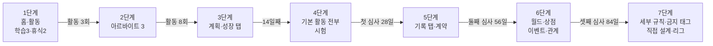
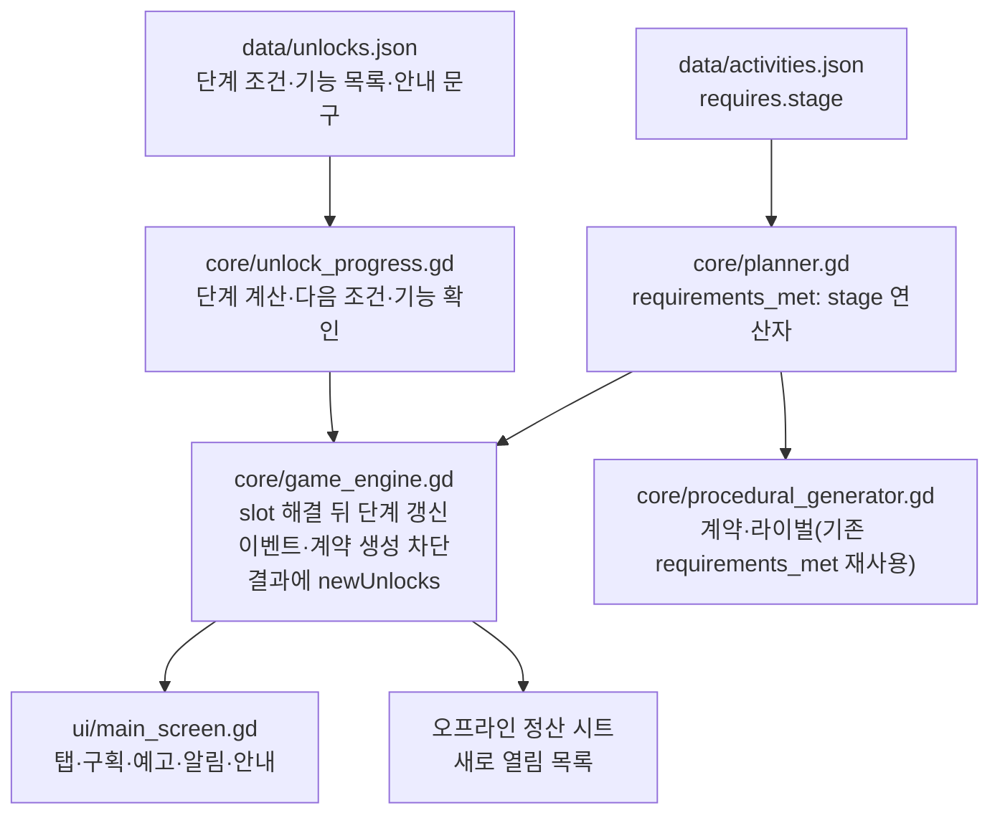

# 설계: 콘텐츠 단계적 해금

- 설계 ID·버전·원본 커밋: `2026-11-progressive-unlock` v1, 원본 `f67378a`(픽셀 UI 개편 완료 main)
- 상태: 승인. 구현과 독립 검수 1회 완료(최종 판정 통과, 기록 `review-1.md`)
- 사용자 결정(2026-11-05, 질문 응답): 해금 범위 "기능과 활동 모두", 열림 조건 "진행 마일스톤", 잠금 표시 "다음 하나만 예고", 해금 속도 "3시즌, 약 7분". 사용자 제안 원문: "게임 콘텐츠가 순서대로 열려야 학습곡선이 낮을 것 같다."
- 승인자·시각·근거·승인 커밋: 사용자, 2026-11-05, 설계·테스트 계획 승인 질문에 "승인 (Recommended)" 응답(독립 검수 1회안). 승인 커밋은 PR-1 병합 커밋
- 관련: 픽셀 UI 설계 `docs/design/2026-11-pixel-raising-ui/`(방향 A 구성요소를 그대로 쓴다), 후속 이슈 #9
- 후속 변경(2026-11-05, 이슈 #11): 결과와 함께 열린 단계는 결과 창 첫 줄로 알리고(자동 진행 포함), 숨은 최소 보유금은 모자란 골드로, 시험 겹침은 실제로 풀리는 날로 안내한다. 기록은 `docs/game-design/ui/review/followup-9-11.md`

## 목적·범위·근거

### 지금 첫 세션에서 일어나는 일 (측정)

`f67378a`에서 성장 방향 8종을 seed 20261104로 2,240일 자동 진행해 측정했다. 하루(slot)는 접속 중 5초, 오프라인 60초다.

| 시점 | 접속 중 시간 | 열려 있는 것 |
|---|---|---|
| 시작 | 0초 | 활동 43개 중 23개(모든 방향 동일), 하단 탭 5개 전부, 계획(방향 9종·규칙 3개·금지 태그), 기록(칭호 38개·계약 3개), 월드, 상점 21종, 설정 |
| 1일째 | 5초 | 첫 이벤트 도착(모든 방향) |
| 5일째 | 25초 | 첫 시험 자동 참가(모든 방향) |
| 28일째 | 2분 20초 | 첫 시즌 심사. 열린 활동 23~27개 |
| 112일째 | 9분 20초 | 열린 활동 25~33개. 이후 방향에 따라 일부 활동은 끝까지 열리지 않음 |

처음 30초 안에 화면 5개, 활동 23개, 이벤트와 시험이 한꺼번에 나온다. 그 뒤에는 새로 열리는 것이 거의 없다. 배울 것은 앞에 몰려 있고, 다음 목표는 보이지 않는다.

### 근거

- Apple Human Interface Guidelines, Onboarding(2026-11-05 확인): "if you try to teach too much, people can feel overwhelmed and may be less likely to remember what they learned." 한 번의 긴 안내 대신 "a collection of context-specific tips"를, 안내는 해당 화면 "near that area"에 두라고 권한다. 기본값을 주고 부가 설정은 뒤로 미루라는 권고("Postpone nonessential setup flows or customization steps")도 있다.
- Nielsen Norman Group, Progressive Disclosure: 주요 기능만 먼저 보여 주고 고급 기능은 뒤로 미루면 배우기 쉽고 실수가 줄어든다.
- 확인하지 못한 것: Google Play 개발자 블로그의 온보딩 글은 접근이 막혀(403) 근거로 쓰지 않는다. 방치형 게임 해금 간격에 관한 GDC 발표(Pecorella 2015·2016)는 제목만 확인했다.

### 기대 결과

새 수련생을 만든 뒤 처음 보는 것은 수련생, 활동 5개, 자동 진행이다. 그 뒤 약 7분(접속 중)에 걸쳐 7단계로 하나씩 열린다. 각 단계에서 새로 배울 것은 1~3개이고, 다음에 무엇이 열릴지는 항상 하나만 예고한다.

### 포함·제외

| 포함 | 제외 |
|---|---|
| 7단계 해금 규칙(데이터), 자동 플래너·즉시 실행·자동 큐·계약·이벤트·도전의 단계 반영 | 기존 활동의 능력치·세계 티어 조건 변경(그대로 둔다) |
| 하단 탭·홈·계획·활동·성장·기록·메뉴·새 수련생 화면의 단계별 표시 | 새 시각 방향(픽셀 방향 A 구성요소를 확장만 한다) |
| 다음 단계 예고 1개, 새로 열림 알림, 화면 첫 진입 안내 1회 | 별도 튜토리얼 화면, 강제 따라하기 |
| 오프라인 정산 시트의 "새로 열림" 목록 | 수치 밸런스 재조정(측정 결과가 기준을 벗어날 때만 품의) |
| 기존 저장의 단계 계산(이미 쓰던 기능이 잠기지 않음), 로컬 분석 이벤트 | 실기기 검증, 스토어 출시 |

설정(접근성·효과음·고대비·모션 줄이기·저장·초기화), 자동 진행 일시정지, 이어하기, 새 수련생 만들기는 단계와 관계없이 처음부터 쓴다.

## 해금 단계

| 단계 | 열리는 조건 | 새로 열림 | 접속 중 | 오프라인만 |
|---|---|---|---|---|
| 1 | 새 수련생 | 홈, 활동 탭. 학습 3종(공식 예절 실습, 왕립 교양학, 기초 호신 훈련), 휴식 2종(기숙사에서 쉬기, 정원 산책) | 0초 | 0분 |
| 2 | 활동 3회 완료 | 아르바이트 3종(공공 돌봄 보조, 식당 주방 지원, 기숙관 운영 보조). 골드를 벌어 학습비를 낸다 | 약 15초 | 약 3분 |
| 3 | 활동 8회 완료 | 계획 탭(성장 방향 8종), 성장 탭(능력치·숙련) | 약 40초 | 약 8분 |
| 4 | 14일째 | 나머지 기본 학습·아르바이트·휴식(기존 능력치 조건은 그대로), 시험(아카데미 종합 시험). 첫 시험은 2시즌 4일째(32일째). 알림 문구는 "학습과 아르바이트 추가, 시험" | 약 70초 | 약 14분 |
| 5 | 첫 시즌 심사(28일째) | 기록 탭(시즌 기록, 진로 칭호), 주간 계약 | 약 2분 20초 | 약 28분 |
| 6 | 두 번째 시즌 심사(56일째) | 월드(모험, 스포츠, 대회), 상점·장비, 이벤트, 관계 | 약 4분 40초 | 약 56분 |
| 7 | 세 번째 시즌 심사(84일째) | 계획 세부 규칙(최소 보유금, 최대 스트레스, 위험 허용), 금지 태그, 직접 설계, 라이벌 리그 | 약 7분 | 약 84분 |

- 조건은 저장된 진행값(완료 활동 수 `lifetimeStats.activities`, 날짜 `time.slot`)으로만 판정한다. 같은 seed와 입력이면 온라인·오프라인 모두 같은 날 같은 단계가 열린다.
- 단계는 내려가지 않는다. 한 번의 정산에서 여러 단계를 넘으면 모두 연다.
- 단계가 열려도 활동 자체의 능력치·세계 티어 조건은 그대로 적용한다. 예를 들어 4단계에서 "정밀 검술 교실"은 근력 50이 되어야 열린다.
- 시즌 도전 일정(`challengeScheduleSlots`)은 바꾸지 않는다. 4단계 전에 돌아오는 시험 날은 건너뛴다.

## 사용자 흐름·화면 상태



### 첫 세션 (접속 중)

| 시간 | 화면 | 플레이어가 배우는 것 |
|---|---|---|
| 0초 | 홈: 수련생, 현재 활동 고리, 자동 진행. 탭은 [홈] [활동]과 예고 1개 | 수련생이 스스로 활동한다 |
| 5~15초 | 결과 띠가 능력치 오름과 골드 감소를 보여 준다. 활동 목록 맨 아래 "곧 열림 · 아르바이트 3종 · 활동 1회 더" | 학습은 골드를 쓰고 능력치를 올린다 |
| 15초 | 결과 창 첫 줄 "새로 열림 · 아르바이트 3종"(자동 진행이어도 이 순간은 결과 창). 활동 목록에 새 행 3개(처음 한 번 "새" 표시) | 아르바이트로 골드를 번다 |
| 40초 | 띠 "새로 열림 · 계획, 성장". 계획 탭을 처음 열면 방향 버튼 옆에 안내 한 줄 | 방향을 바꾸면 다음 활동부터 고르는 것이 달라진다 |
| 70초 | 띠 "새로 열림 · 기본 활동, 시험". 활동 목록이 분류 필터와 함께 늘어난다 | 시험은 정해진 날 자동 참가한다 |
| 2분 20초 | 첫 시즌 심사 결과 창, 첫 줄 "새로 열림 · 기록, 계약" | 시즌마다 명성과 진로 칭호를 받는다 |
| 약 2분 40초 | 첫 시험 결과 창(점수와 다음 준비) | 도전 결과와 준비 조언 |
| 4분 40초 | 두 번째 심사 결과 창, 첫 줄 "새로 열림 · 월드, 상점, 이벤트" | 모험·장비·이벤트 선택 |
| 7분 | 세 번째 심사 결과 창, 첫 줄 "새로 열림 · 세부 규칙, 직접 설계" | 지킬 선과 세부 가중치를 정한다 |

### 오프라인으로 돌아온 경우

설치 직후 앱을 닫고 2시간 뒤 돌아오면 정산 시트가 120일을 처리하고 "새로 열림" 목록에 2~7단계를 한꺼번에 보여 준다. 띠 알림은 띄우지 않고, 각 화면의 첫 진입 안내는 그대로 한 번씩 보여 준다.

### 화면별 상태

| 화면 | 단계별 표시 |
|---|---|
| 하단 탭 | 열린 탭만 보인다. 다음 단계가 탭을 연다면 그 탭 하나를 자물쇠와 조건("계획 / 활동 5회 더", "기록 / 14일 뒤")으로 보여 주고, 누르면 같은 문구 알림을 띄운다. 시즌 심사 조건은 남은 날로 보여 준다. 7단계 뒤에는 탭 5개 전부 |
| 홈 | 1~4단계에는 "월드 출정" 버튼 자리를 비우지 않고 아래 내용을 위로 당긴다. 5단계에는 그 자리에 예고 "월드 출정 / N일 뒤"를 보인다. 6단계부터 월드 버튼 |
| 활동 | 열린 활동만 보인다. 분류 필터는 열린 분류만. 다음 단계가 활동을 연다면 목록 끝에 "곧 열림" 행 1개 |
| 계획 | 3단계: 성장 방향 8종. 7단계: 세부 규칙, 금지 태그, 직접 설계. 3~6단계에는 세부 규칙 자리에 예고 행 1개(7단계가 다음일 때) |
| 성장 | 3단계: 능력치·숙련. 6단계: 장비 슬롯, 관계 |
| 기록 | 5단계부터. 월드·상점 버튼은 6단계부터 |
| 메뉴 시트 | 설정·저장·이어하기·새 수련생은 항상. 월드·상점은 6단계부터 |
| 새 수련생 | 성장 방향 8종 중 하나를 고른다. 새 수련생은 1단계부터 시작하므로 "직접 설계"는 보이지 않는다 |
| 현재 활동 이유 줄 | 아직 열리지 않은 개념(위험, 금지 태그, 계약)은 이유에 쓰지 않는다. 잠금 이유도 같아서, 7단계 전의 최소 보유금 제외와 비용 부족은 비용과 최소 보유금을 합쳐 모자란 골드("골드 82G 더 필요")로 보인다 |

새 단계를 연 진행에서 끝난 결과가 있으면 새로 열림은 결과 창의 첫 줄(강조색, 띄어쓰기 단위로 2줄까지, 상세 4줄 상한에 포함)로 보이고 알림 띠에는 넣지 않는다. 평소 한 줄 결과 띠로 끝나는 자동 진행도 이 순간은 결과 창으로 보여, 한 줄 띠와 알림 띠가 겹치지 않게 한다. 끝난 결과가 없을 때(예: 진행 중에 14일째가 됨)는 다른 알림과 같은 알림 띠(PixelToast, 2.2초, 입력 통과)를 쓰고, 그 2.2초 안에 다른 알림이 오면 함께 보여 덮이지 않게 한다. 화면 첫 진입 안내는 해당 구획 제목 바로 아래 안내 띠(PixelInset)로 보인다. 한 화면 방문에는 안내를 하나만 보여 주고, "알겠어요"를 누르면 같은 화면의 다음 안내가 이어서 보인다. 본 안내는 다른 탭으로 가거나 재실행하면 다시 뜨지 않는다. 모션 줄이기에서는 띠 슬라이드 없이 바로 표시한다.

## 구조·책임·의존성



- 규칙은 `godot/src/core/`, 화면은 `godot/src/ui/`, 수치는 `godot/data/`에 둔다(프로젝트 지침).
- 활동 해금은 `activities.json`의 `requires.stage`가 정본이다. 기존 `requirements_met`에 `stage` 연산자 하나를 더하므로 플래너, 즉시 실행, 자동 큐, 계약 생성이 같은 판정을 쓴다.
- 기능 해금(탭, 계약, 이벤트, 월드, 상점, 관계, 세부 규칙, 직접 설계, 리그)은 `unlocks.json`의 단계별 `features` 목록이 정본이다. 엔진은 `is_feature_unlocked(id)`와 `unlock_status()`를 공개한다.
- 화면은 엔진이 돌려주는 상태만 읽는다. 화면이 단계를 따로 계산하지 않는다.
- 로컬 분석 훅에 `feature_unlocked {stage, features, slot, source: online|offline}`를 보낸다.

## 데이터·인터페이스·실패 처리

```jsonc
// godot/data/unlocks.json
{
  "stages": [
    {"stage": 1, "when": {}, "features": ["home", "activity"], "tips": {}},
    {"stage": 2, "when": {"activities": 3}, "features": [], "label": "아르바이트 3종"},
    {"stage": 3, "when": {"activities": 8}, "features": ["plan", "growth"], "label": "계획, 성장",
     "tips": {"plan": "성장 방향을 바꾸면 다음 활동부터 수련생이 고르는 활동이 달라져요."}},
    {"stage": 4, "when": {"slot": 14}, "features": ["challenge"], "label": "기본 활동, 시험"},
    {"stage": 5, "when": {"seasonReviews": 1}, "features": ["record", "contracts"], "label": "기록, 계약"},
    {"stage": 6, "when": {"seasonReviews": 2}, "features": ["world", "shop", "events", "relations"], "label": "월드, 상점, 이벤트"},
    {"stage": 7, "when": {"seasonReviews": 3}, "features": ["rules", "bannedTags", "customWeights", "league"], "label": "세부 규칙, 직접 설계"}
  ]
}
```

- 저장 필드: `unlocks: {stage: int, announced: int, tipsSeen: [featureId]}`. `stage`는 엔진만 쓴다. `announced`(띠 알림을 띄운 단계)와 `tipsSeen`은 화면 상태다. `schemaVersion`은 2 그대로 두고 기본값을 채우는 추가 필드로 넣는다.
- 기존 저장(이 필드가 없는 v2): 불러올 때 진행값으로 단계를 계산하고 `announced = stage`, `tipsSeen = 전체`로 둔다. 84일 넘게 진행한 저장은 7단계가 되어 지금처럼 모든 기능을 쓴다. 기존 플레이어에게 알림이 쏟아지지 않는다.
- 이미 진행 중인 활동, 자동 큐에 있는 활동, 고정한 계약은 단계가 낮게 계산되어도 취소하지 않는다(기존 저장에서만 생길 수 있다). 다음 선택부터 단계 규칙을 적용한다.
- 이벤트: 6단계 전에는 이벤트를 만들지 않는다(난수도 쓰지 않는다). 6단계 전 저장의 이벤트함에 남은 항목은 그대로 해결할 수 있다.
- 계약: 5단계 전에는 생성·진행 추적을 하지 않는다. 5단계에 들어선 주부터 생성한다.
- 데이터 검증(`check_content.sh`, 콘텐츠 테스트): 단계 번호가 1부터 연속, 조건이 단조 증가, 모든 기능 ID가 화면 목록에 있음, 모든 활동의 `requires.stage`가 1~7, 휴식 `REST_HOME`이 1단계.
- 결정성: 단계 판정은 난수를 쓰지 않는다. 이벤트 차단으로 6단계 전 난수 사용 순서가 지금과 달라진다. 같은 seed의 결과는 이전 버전과 달라지지만, 새 버전 안에서는 온라인·오프라인이 같다.

## 품질 요구사항

- 접근성: 설정과 접근성 옵션은 1단계부터 쓴다. 예고 행과 잠긴 탭도 터치 44×44, 대비 4.5:1, 글자 16px을 지킨다. 잠금은 자물쇠 아이콘과 문구로 보여 주고 색에만 기대지 않는다.
- 레이아웃: 하단 탭 2~5개(+예고 1개) 모든 경우에 390×844, 430×932, 720×1280에서 잘림·겹침이 없고 PX-05 짝수 격자를 지킨다.
- 밸런스(같은 seed 20261104, 성장 방향 8종): 모든 방향이 84일째에 7단계에 도달한다. 112일째 능력치 합이 `f67378a` 기준의 90% 이상이다. 기준값은 아래와 같다.

| 방향 | 28일 | 84일 | 112일 | 336일 |
|---|---:|---:|---:|---:|
| 균형 | 1351 | 1855 | 2138 | 4156 |
| 무예 | 1386 | 2063 | 2441 | 4780 |
| 학문 | 1345 | 1885 | 2175 | 4287 |
| 예술 | 1384 | 1994 | 2289 | 4609 |
| 리더십 | 1220 | 1827 | 2127 | 4394 |
| 돌봄 | 1366 | 2063 | 2388 | 4942 |
| 탐험 | 1278 | 1882 | 2109 | 4473 |
| 번영 | 1219 | 1725 | 1982 | 3938 |

  초반 활동 선택지가 줄어 28일 수치는 낮아질 수 있다. 112일 기준을 못 맞추면 수치를 임의로 고치지 않고 측정 결과와 조정안을 품의한다.
- 성능: 단계 판정은 slot마다 정수 비교 몇 번이다. 오프라인 480 slot 정산 시간이 지금보다 5% 이상 늘지 않는다.

## 대안·주요 결정

| 결정 | 고른 것 | 다른 안과 이유 |
|---|---|---|
| 범위 | 기능과 활동 모두(사용자 선택) | 기능만: 처음부터 활동 23개가 남는다. 활동만: 첫 화면부터 계획·월드·상점이 다 보인다 |
| 열림 조건 | 진행 마일스톤(사용자 선택) | 시간 고정: 방금 한 일과 새 기능이 이어지지 않는다. 안내 과제: 과제를 안 하면 자동·오프라인 진행에서도 계속 잠긴다 |
| 잠금 표시 | 다음 하나만 예고(사용자 선택) | 모두 잠금 표시: 첫 화면 정보량이 지금과 비슷하다. 완전 숨김: 다음 목표가 없다 |
| 속도 | 3시즌, 약 7분(사용자 선택) | 1연차 9분, 2연차 19분: 짧게 확인하는 플레이어가 첫날 월드·상점을 못 볼 수 있다 |
| 단계 저장 | 상태에 `unlocks.stage` 저장 | 매번 진행값에서 계산: 저장은 필요 없지만, 조건을 나중에 바꾸면 기존 플레이어의 기능이 잠길 수 있다. 저장하면 단조성을 보장한다 |
| 활동 해금 위치 | `activities.json`의 `requires.stage` | `unlocks.json`에 활동 목록: 활동 정의와 해금이 두 파일로 갈라진다 |
| 시험 일정 | 바꾸지 않음(첫 시험 32일째) | 첫 시즌 시험을 14일 뒤로 옮기면 모든 시즌 일정과 라이벌 보정이 바뀐다 |

가정: 접속 중 1일 5초, 오프라인 60초는 바꾸지 않는다. 틀리면 표의 시간 열만 달라진다.

## 인수조건·테스트·검수

| 조건 ID | 관찰할 동작·통과 기준 | 테스트 방법·환경 | 격리 데이터·시작 상태 | 기대 결과 | 증거 |
|---|---|---|---|---|---|
| AC-UNLOCK-01 | 새 게임에서 탭은 홈·활동 2개, 활동은 5개만 보이고, 다음 단계 예고는 1개(활동 목록 끝)다 | E2E 좌표 탭, 렌더링 캡처 | `user://e2e/<viewport>`, 고정 시계 | 탭 2, 예고 1, 활동 행 5 | journey.json, PNG |
| AC-UNLOCK-02 | 활동 3회·8회, 14일째, 심사 1·2·3회에 해당 단계가 열리고 내려가지 않는다 | 코어 테스트(test_runner) | seed 고정 새 상태 | 단계 1>2>3>4>5>6>7 | 테스트 로그 |
| AC-UNLOCK-03 | 플래너·즉시 1회·자동 큐는 열리지 않은 활동을 고르거나 실행하지 않는다 | 코어 테스트 + E2E | 1단계 상태에서 잠긴 활동 실행 시도 | 거절, 쉬운 문구 | 로그 |
| AC-UNLOCK-04 | 이벤트는 6단계 전, 계약은 5단계 전, 시험 자동 참가는 4단계 전에 생기지 않는다 | 코어 테스트 | 84일 진행 | 첫 이벤트 ≥56일, 첫 계약 ≥28일, 첫 시험 32일 | 로그 |
| AC-UNLOCK-05 | 같은 seed·입력은 온라인 진행과 오프라인 정산에서 같은 날 같은 단계·같은 상태 해시 | 코어 테스트 | 120일 온라인 vs 오프라인 | 해시 동일 | 로그 |
| AC-UNLOCK-06 | 오프라인 정산으로 여러 단계가 열리면 정산 시트에 "새로 열림" 목록이 보이고 띠 알림은 뜨지 않는다 | E2E 복귀 여정 | 시계 +2시간 | 목록 표시 | PNG |
| AC-UNLOCK-07 | `unlocks`가 없는 기존 v2 저장은 진행값으로 단계를 계산하고 알림·안내를 띄우지 않는다. 84일 이상이면 모든 기능 사용 | 코어 테스트 + UI 테스트 | `f67378a` 형식 저장 | 7단계, 알림 0 | 로그 |
| AC-UNLOCK-08 | 설정·접근성·저장·이어하기·새 수련생·일시정지는 1단계에서 쓸 수 있다 | E2E | 새 게임 | 도달 | journey.json |
| AC-UNLOCK-09 | 새 단계마다 새로 열림 1회(끝난 결과가 있으면 결과 창 첫 줄, 없으면 띠), 해당 화면 첫 진입 안내 1회. 재실행 뒤 다시 뜨지 않는다 | UI 테스트 + E2E | 저장·재실행 | 각 1회 | 로그, PNG |
| AC-UNLOCK-10 | 8개 방향 모두 84일째 7단계, 112일 능력치 합이 기준의 90% 이상, 활동 정체 없음 | 해금 진행 측정 테스트(npm test에 포함) | seed 20261104 | 기준 충족 | 로그 |
| AC-UNLOCK-11 | 탭 2~5개+예고 모든 단계에서 필수 CTA 잘림 없음, 짝수 격자, 대비 | layout_probe 확장 | 단계 1~7 상태 | 통과 | 로그 |
| AC-UNLOCK-12 | 이유 줄에 아직 열리지 않은 개념이 나오지 않는다 | UI 테스트 | 단계 1~6 | 해당 단어 없음 | 로그 |

- TDD: AC-UNLOCK-02~05, 07, 10, 12는 실패하는 테스트를 먼저 쓴다. 화면 배치(01, 06, 09, 11)는 E2E·레이아웃 테스트를 먼저 바꿔 실패를 확인한 뒤 구현한다.
- 기존 E2E 첫 실행 여정은 월드·상점을 첫 세션에 들른다. 이제 그 경로는 "84일 진행 뒤"에만 있으므로, 여정을 1단계 확인 → 활동으로 2·3단계 → 시계 이동과 오프라인 정산으로 7단계 → 기존 월드·상점·설정 경로 순서로 바꾼다. 좌표 탭으로만 이동하는 규칙은 유지한다.
- 기존 인수조건 개정: AC-PLAN-01 "잠금"에 단계 포함, AC-UI-02 "12개 기능 경로는 해당 단계가 열린 뒤 도달 가능"으로 바꾸고 AC-UNLOCK-01~12를 문서 11에 추가한다.

| 항목 | 값 |
|---|---|
| 등급 | L3 전체 회귀. 플래너·이벤트·계약·도전·저장이 바뀌어 회귀 경로 전체에 영향 |
| 실행 환경 | 개발 환경(Godot headless E2E, 렌더링, 코어 테스트). 기기 사용 없음. 단계 해금은 규칙·화면·저장 변경이라 개발 환경에서 모두 확인한다 |
| 검증기 하한과 낮춘 항목·사유 | seoleeapps 저장소라 Seorilabs 중앙 검증기 대상이 아니다. 저장소 게이트(`npm test`, `test:e2e`, `capture:e2e`, `test:balance`, `build:web`)를 쓴다 |
| 새 화면·UI 개편 | 아니오. 기존 화면에 상태를 더하고 승인된 구성요소만 쓴다. 대신 L3 실행과 첫 세션 UX를 구현자와 다른 에이전트가 1회 독립 검수한다 |
| 출시 마켓·끝 지점 | 출시 없음(GDD §13). 끝 지점은 main 병합 |

- 실행 못할 조건: 실기기 첫 세션 체감(기기 사용 승인 없음, 필요하지 않음).

## 적용·운영·되돌리기

1. 규칙: GDD·구현계약 개정, `unlocks.json`, `activities.json`의 `requires.stage`, 코어 단계 계산·플래너·이벤트·계약·도전 차단, 저장 기본값·기존 저장 계산, 코어 테스트와 해금 진행 측정 테스트.
2. 화면: 탭·홈·계획·활동·성장·기록·메뉴·새 수련생 단계 표시, 예고, 새로 열림 띠, 첫 진입 안내, 정산 시트 목록, E2E 여정·레이아웃 프로브·렌더 캡처, `docs/12`·`docs/qa` 갱신.
3. 독립 검수 1회(L3 전체 실행과 첫 세션 UX) → 범위 안 수정 → main 병합.

1·2는 처음에 PR 두 개로 나누려 했지만, 로컬 리뷰(2026-11-05)가 규칙만 먼저 병합하면 계약의 화면 기준이 main에서 미구현 상태가 된다고 지적해 한 PR의 커밋 두 개로 합쳤다.

- PR마다 로컬 mcode 리뷰를 돌리고, `npm test`와 `test:e2e`가 통과하면 squash 병합한다.
- 증거 원본은 NAS1dual `agent-artifacts/princess-tycoon/<날짜>/<SHA>/`에 옮기고 Git에는 위치만 남긴다.
- 되돌리기: PR 되돌림. 새 저장 필드 `unlocks`는 이전 버전이 무시하므로 저장 손상은 없다.
- 남은 위험: 초반 선택지가 줄어 28일 성장이 느려질 수 있다(AC-UNLOCK-10으로 측정). 오프라인으로만 플레이하면 7단계까지 약 84분이다.

## 승인·추적

- 원본 커밋 `f67378a`. 승인 커밋과 PR 번호는 승인 뒤 기록한다.
- 측정 스크립트(해금 시점, 성장 기준)는 PR-1에서 `godot/tests/unlock_pacing_smoke.gd`로 옮겨 상시 테스트로 둔다.
